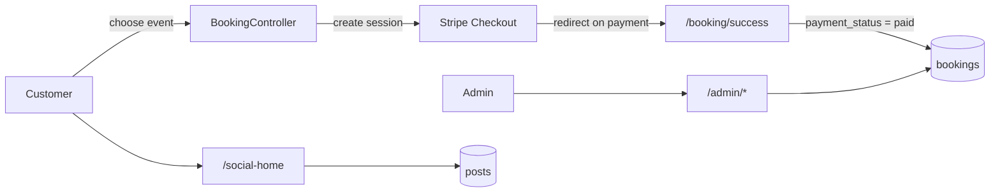

<div align="center">


</div>

A Laravel application where an admin creates events and event types, and customers register, book and pay for events. It also includes a small social feed where registered customers can post and view profiles.

## ✨ Features

- 🗓️ **Admin back office** for event types, events (multiple images, price), services, customers, bookings and testimonials
- 🎟️ **Customer booking flow** with adult/child counts, a total price and a booking reference
- 💳 **Stripe Checkout** payment, with success and failure pages that record the booking once Stripe reports it paid
- 🧑‍🤝‍🧑 **Customer registration and login**
- 💬 **Social feed**: create, edit and delete posts (with optional image), account and settings pages, and public profile pages
- 🌐 **Public site**: home, service list and detail, about us, contact form (sent by email) and customer testimonials
- 🛎️ Bookings created by customers (`front`) are distinguished from those entered by an admin (`admin`)

## 🏗️ Architecture



## 🧰 Tech stack

| Layer | Technology |
| --- | --- |
| Backend | PHP 8, Laravel 9, Livewire 2, Sanctum |
| Payments | stripe/stripe-php (Checkout) |
| Frontend | Blade templates, Vite |
| Database | MySQL (via `.env`) |
| Mail | Laravel Mail (contact form) |

## 🚀 Getting started

```bash
git clone https://github.com/Brian-Dol/Laravel-Event-Booking-Platform-with-Social-Media-Platform.git
cd Laravel-Event-Booking-Platform-with-Social-Media-Platform

composer install
cp .env.example .env
php artisan key:generate
# create a MySQL database and set DB_* and MAIL_* values in .env
php artisan migrate
php artisan storage:link
php artisan serve
```

The seeder is empty, so create the first admin row in the `admins` table yourself (the admin login at `/admin/login` compares a SHA-1 hashed password).

## 📁 Project structure

```text
app/Http/Controllers/   Admin CRUD, booking/payment, customers, social posts, public pages
app/Models/             Event, EventType, Eventimage, Booking, Customer, Service, Post, Testimonial, Admin
database/migrations/    Schema for the above
resources/views/        Public pages, admin dashboard, booking and social views
```

## 🗺️ Notes

This was an early learning project and is **not production-ready**:

- The Stripe test key, currency (INR), success URL and contact-form email addresses are hard-coded in the controllers; they should move to `.env`/config, and the committed test key should be rotated.
- Admin and customer login use custom session logic rather than Laravel guards, and admin routes are not protected by route middleware. Admin passwords are SHA-1 hashed.
- Deletes are performed through `GET` routes.
- Likes and comments on the social feed are not implemented.

## 👤 Author

**Brian Dol**, Senior Full Stack Engineer · [Portfolio](https://portfolio.dol-brian23.workers.dev/) · [LinkedIn](https://linkedin.com/in/brian-dol-31a06115a/)
